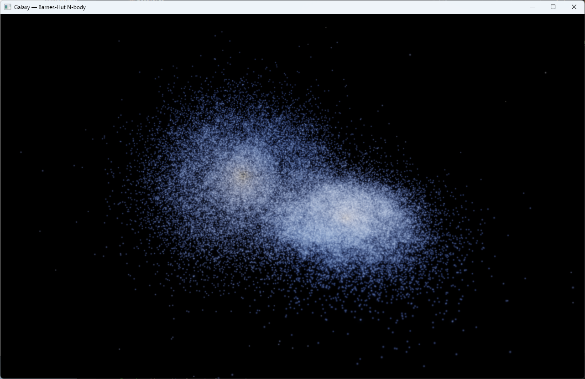

# Galaxy

A real-time 3D gravitational N-body sandbox written from scratch in Rust — a
spiral galaxy (or a two-galaxy collision) simulated body-by-body and rendered
with raw OpenGL.

No game engine. No physics library. No linear-algebra crate. The simulation core
has **zero external dependencies**; the only crates in the project exist to open a
window and talk to the GPU.



## What it actually does

Every star is an independent body under Newtonian gravity. With *N* stars a naive
solver costs *O(N²)* per step and dies well before it looks like a galaxy. This
uses a **Barnes-Hut octree** to approximate distant groups of stars by their
centre of mass, bringing each step down to *O(N log N)* and making ~10⁵ bodies
interactive on a normal multicore desktop.

The disk starts cold and rotating; small velocity dispersion seeds the
gravitational instabilities that wind up into spiral arms on their own. Nobody
draws the arms — they emerge.

## Highlights

- **Morton-ordered Barnes-Hut octree** — bodies are re-sorted along a Z-order
  curve every step, so each node owns a contiguous range of bodies. The tree is
  built top-down into a flat pre-order array with skip links: no pointers, no
  recursion in the force walk, leaves of up to 16 bodies, and spatial neighbours
  next to each other in memory.
- **Group walk** — one tree traversal per leaf builds an interaction list shared
  by all bodies of that leaf; the list is summed in a branch-free loop the
  compiler turns into SIMD.
- **Safe opening criterion** — a cell is approximated only if the whole group is
  farther than `size / θ + |com − cell centre|` (Barnes 1994), so a body is never
  approximated by a cell that contains it.
- **Symplectic leapfrog** integrator (kick-drift-kick) — energy stays bounded
  instead of drifting away.
- **Dependency-free parallelism** — force evaluation is spread across cores with
  `std::thread::scope` and a work queue (dense regions cost more; idle threads
  take the next batch). No `rayon`.
- **Simulation on its own thread** — rendering and the camera stay smooth even
  when a step takes longer than a frame; the renderer always draws the newest
  snapshot.
- **Raw OpenGL renderer** (`glow`, GL 3.3 core) — stars are soft additive point
  sprites coloured by speed; an HDR bloom post-process gives the glow.
- **Hand-rolled math** — `Vec3` and a column-major `Mat4` (perspective, look-at).

## Build & run

```bash
cargo run --release
```

Requires Rust 1.85+ (edition 2024) and an OpenGL 3.3 capable GPU / driver.
Dependencies: `winit` 0.30, `glutin` 0.32, `glutin-winit` 0.5, `glow` 0.18.

## Controls

| Input        | Action                              |
|--------------|-------------------------------------|
| left-drag    | orbit the camera                    |
| mouse wheel  | zoom                                |
| `Space`      | pause / resume                      |
| `↑` / `↓`    | simulation speed (steps per frame)  |
| `B`          | toggle bloom                        |
| `[` / `]`    | bloom intensity                     |
| `-` / `=`    | star brightness                     |
| `M`          | switch single galaxy / merger       |
| `R`          | reset the current scene             |
| `Esc`        | quit                                |

## Accuracy and performance

Measured on the default disk (40 001 bodies, softening 0.5) against direct
*O(N²)* summation:

| θ    | mean rel. error | max rel. error |
|------|-----------------|----------------|
| 0.6  | 0.25%           | 1.4%           |
| 0.8  | 0.41%           | 2.8%           |
| 1.0  | 0.60%           | 8.7%           |

The app runs at θ = 0.8. Energy drift with the app's settings (dt = 0.0015,
θ = 0.8, N = 3000, 400 leapfrog steps): **0.03%**.

Step time at θ = 0.8 on a 2-core virtual machine: 10 ms for 20k bodies, 23 ms
for 40k, 70 ms for 100k. A desktop with more cores divides that accordingly.

## Layout

```
src/main.rs            entry point
src/app.rs             window, GL context, input, frame loop, HUD
src/camera.rs          orbit camera
src/math.rs            Vec3 + column-major Mat4 (perspective, look_at)
src/sim/mod.rs         body state, leapfrog, Morton sorting
src/sim/octree.rs      Barnes-Hut octree and the group force walk
src/sim/galaxy.rs      rotating-disk initial conditions, scenes
src/sim/parallel.rs    dependency-free scoped parallel-for
src/sim/worker.rs      simulation thread and snapshot hand-off
src/gfx/stars.rs       star point sprites
src/gfx/bloom.rs       HDR target + bloom (bright pass, separable blur, composite)
src/gfx/text.rs        bitmap-font HUD text
src/gfx/font.rs        embedded font atlas (font_atlas.r8)
src/gfx/shaders/       GLSL sources
```

## Tuning

- `src/sim/worker.rs`: `SIM_PARAMS` — time step, opening angle θ, softening.
- `src/sim/galaxy.rs`: star counts and disk parameters of each scene.
- `src/gfx/stars.rs`: sprite size (`POINT_SCALE`) and default brightness.
- `src/gfx/bloom.rs`: bloom threshold, intensity and blur iterations.

## How it works (short version)

1. Sort the stars along a Morton curve and build the octree over the sorted
   order; each node stores its total mass and centre of mass.
2. For each leaf, walk the tree once: cells far enough from the whole leaf
   (`size / distance < θ`, with the safety offset) become single point masses;
   nearer cells are opened down to their stars. Every star in the leaf then sums
   that list.
3. Advance positions and velocities with leapfrog, reusing the previous step's
   acceleration for the first half-kick — this is what keeps energy stable.
4. The simulation thread publishes positions + speeds; the render thread uploads
   them, draws additive sprites into an HDR target, blurs the bright parts and
   adds them back for bloom.

## License

MIT.

## Support

If you found this project interesting or useful, you can support my work:

[](https://github.com/sponsors/makarov-mm)
